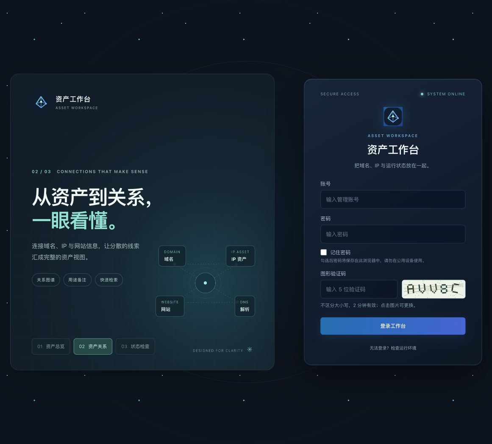
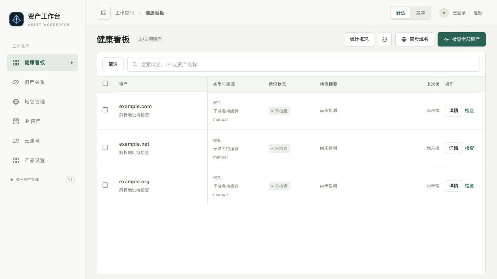
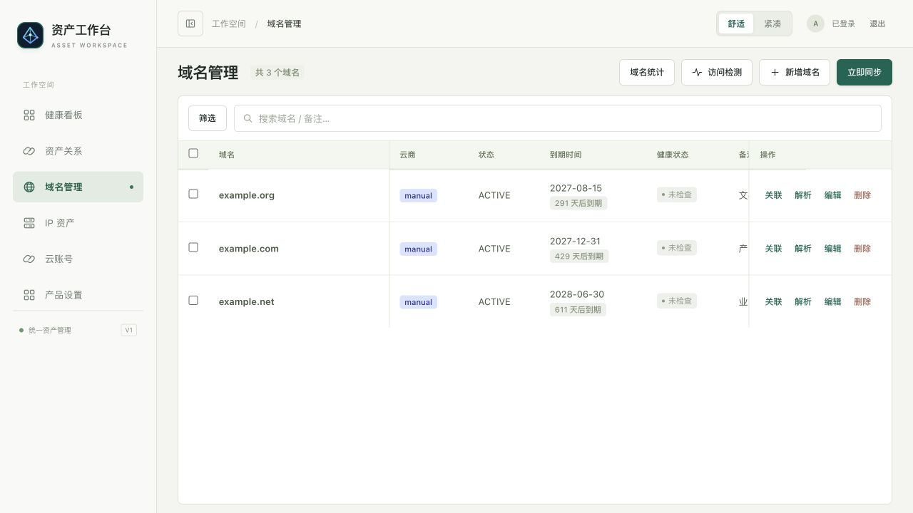
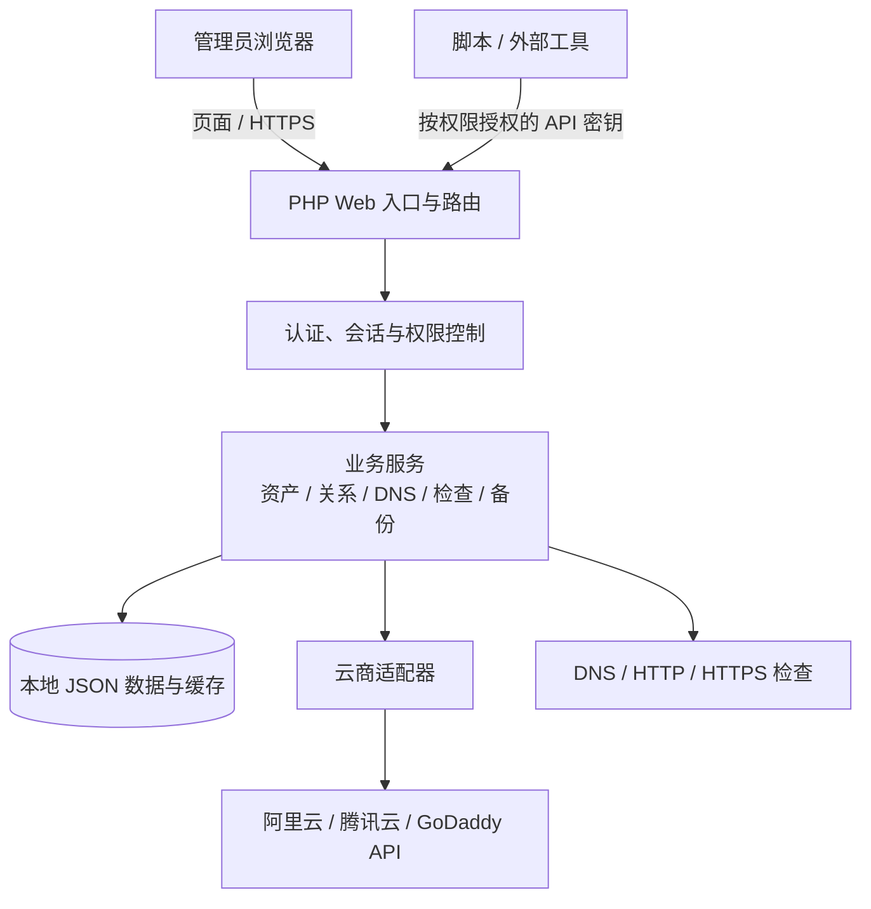

# 资产工作台 · Asset Workspace

**把分散的域名、IP 和网站资料放到一起，让资产关系与检查结果一目了然。**

资产工作台是一款可自行部署的 PHP 资产管理工具，适合管理多个域名、服务器或网站的个人与小团队。它将云账号中的域名和手工登记的 IP 汇总成一份可搜索的台账，并提供 DNS 管理、关系查看和按需检查。

[快速开始](#快速开始) · [产品能做什么](#产品能做什么) · [使用流程](#一个典型的使用流程) · [架构设计](#架构设计) · [详细文档](docs/00-目录.md)

> 当前版本：1.2.0。项目以单管理员、自行部署为定位；示例和截图中的资产均为合成数据。

## 产品界面

登录页提供三款可切换的产品介绍海报，选择保存在当前浏览器。



健康看板集中展示资产和最近检查结果，支持搜索、筛选与手动检查。



域名管理集中查看来源、到期时间、状态和备注，并可进入关联或 DNS 管理。



## 为什么需要它

当域名分散在不同云账号，IP 和网站用途分别记录在表格、聊天记录或个人笔记中时，查找信息和交接都容易花费时间。资产工作台把这些资料放到同一个界面，让你能够回答：

| 常见问题 | 工作台如何帮助 |
| --- | --- |
| 我有哪些域名和 IP？ | 同步云账号域名，也可以手工维护域名及公网 IP。 |
| 这个域名或 IP 用来做什么？ | 记录用途、备注和网站链接，并通过搜索快速查找。 |
| 域名和服务器之间有什么关系？ | 展示 DNS 观察到的关系和人工确认的绑定。 |
| 资产目前是否可以访问？ | 手动运行检查，查看状态、时间和结果证据。 |
| 如何接入脚本或外部工具？ | 通过带权限范围和期限的 API 密钥访问 OpenAPI 接口。 |

## 产品能做什么

| 模块 | 主要能力 |
| --- | --- |
| 健康看板 | 通过 Tab 分别查看域名与 IP 的列表、检查结果和状态分布；支持搜索、筛选和按需检查。 |
| 检查日历 | 按日期选择心情、写一句话、维护待办；通过分类查看资产状态及检查记录。 |
| 资产关系 | 按域名或服务器切换查看关系与状态统计，区分 DNS 观察与人工绑定。 |
| 域名管理 | 手工维护域名资料，或从阿里云、腾讯云和 GoDaddy 多账号同步。 |
| DNS 管理 | 查看及修改解析记录；变更前核对版本，提交后回读并记录结果。 |
| IP 资产 | 登记公网 IPv4 / IPv6，维护名称、用途、备注和网站链接。 |
| 云账号与设置 | 维护云账号、测试连接、配置网络代理及管理员登录信息。 |
| 数据与交付 | 资产备份、JSON 导出与恢复预览、CSV 导出、部署自检和操作记录。 |
| API 接入 | 提供 OpenAPI 3.1 描述和可设定权限、有效期的 API 密钥。 |

## 一个典型的使用流程


例如：先同步 `example.com`，再登记一台公网 IP 并补充用途；随后在资产关系中核对 DNS 观察到的线索，按实际情况添加人工绑定。需要了解运行状态时，再手动发起检查。

**几个容易混淆的概念：**

- **同步域名**是从云账号读取域名；**刷新 DNS 快照**是读取解析记录；**检查资产**是主动执行网络检测。三者互不等同。
- **DNS 观察**表示解析指向某个 IP，该地址可能是 CDN 或代理入口；**人工绑定**记录的是用户确认的关系。
- 检查结果是某个时间点的证据。未检查和过时结果分别显示，不能视为当前正常。

## 快速开始

### 1. 准备环境

- PHP 7.4 或更高版本，建议 PHP 8.x；安装 `curl`、`mbstring` 扩展。
- 运行检查需要可用的 PHP CLI、`proc_open` 和本机 DNS 解析能力。
- 本地体验可使用 PHP 内置服务器；生产环境请将 Web 根目录指向 `public/`，并配置 HTTPS。

### 2. 启动

在项目根目录运行：

```bash
./start.sh
```

也可以直接启动：

```bash
php -S 127.0.0.1:8080 -t public public/index.php
```

浏览器访问 `http://127.0.0.1:8080`。新安装在页面创建管理员，已有安装沿用原配置。PHP 内置服务器用于本地体验，生产部署请参考 [Nginx 示例](deploy/nginx.conf.example) 和 [安装与 API 接入](docs/01-产品介绍/02-安装与API接入.md)。

### 3. 开始使用

1. 在“云账号”添加账号并测试连接，或直接手工登记资产。
2. 同步域名，按需补充 IP、备注和网站链接。
3. 打开“资产关系”核对关联；在“健康看板”手动执行检查。
4. 在“产品设置 → 数据与交付”查看自检，并按需备份或导出。

## 架构设计



浏览器负责展示和交互；PHP 负责身份校验、业务逻辑和云商调用；数据与缓存保存在部署实例中。不同云商通过适配器接入，避免页面直接处理各家的接口差异。

| 位置 | 职责 |
| --- | --- |
| `public/` | Web 入口、页面、样式与前端脚本；Web 服务只公开此目录。 |
| `app/controllers/` | 接收请求并组织响应。 |
| `app/services/` | 资产、检查、DNS、配置、备份等业务规则。 |
| `app/providers/` | 阿里云、腾讯云和 GoDaddy 的接口适配。 |
| `app/core/` | 路由、认证、HTTP 与数据存储等基础能力。 |
| `config/`、`data/` | 实例配置、凭据、资产和运行数据，不应公开或提交。 |
| `scripts/`、`tests/` | 运维、打包脚本与自动化测试。 |

## 结果与使用边界

- 域名检查包括 DNS、HTTP 和 HTTPS，HTTPS 会校验证书；HTTP 和 HTTPS 均返回 2xx / 3xx 才计为正常。IP 检查访问 `http://IP/`，HTTP 2xx / 3xx 视为正常且不跟随跳转。这不能保证网站业务本身正常。
- 检查由用户手动触发；批量检查由浏览器分批发起，期间需要保持页面打开。默认全局检查主域名和 IP，不检查子域名；点击主域名进入详情后可手动检查其子域名，也可以选择“检查所有域名（含子域名）”。每次实际完成的单项检查都会写入日历；只有完整全局检查才生成汇总，中途停止或失败的已完成项仍保留明细。后台定时任务和外部告警尚未提供。
- 选择检查所有域名及子域名时，首次读取尚未缓存的云账号 DNS 记录，之后复用按账号及域名保存的快照；可在域名详情或 DNS 管理中手动刷新。只检查缓存中可作为网站访问的子域名；泛解析和仅 TXT / MX 等记录不作为网站检查。
- 日历打卡、待办及全局检查汇总保存在 `data/calendar.json`，逐项检查明细保存在 `data/health.json`；均不包含在当前资产备份 / 导出中，资产恢复会清空检查明细。迁移或恢复前请另行安全备份这些文件。新的逐项检查才会出现在日历中，不会自动补录旧历史。
- 当前为单管理员产品，暂无多人角色、客户隔离或内置聊天助手。
- JSON 资产导出和服务器备份不包含云凭据、管理员配置、API 密钥或检查缓存；恢复会全量替换资产，执行前可预览并自动留底。CSV 用于交接，不支持导入。详见 [备份恢复](docs/04-交付与维护/04-备份恢复与版本交付.md)。
- 基础操作记录用于查看已认证写请求的时间、操作者、路由和结果，并非不可篡改审计系统；DNS 变更另有前后值记录。

## 安全、密码与网络

- 登录使用图形验证码和限流。登录页的“记住密码”会把账号和密码**明文保存在当前浏览器本地存储**；取消勾选可删除，请勿在公用设备使用。
- 忘记管理员密码时，在部署服务器的项目目录中运行 `php scripts/reset-admin-password.php`，按提示输入新密码。重置会保留资产和云账号，但原登录会话与 API 密钥失效。
- 云凭据保存在服务器私有配置中。生产环境应使用 HTTPS、最小权限云凭据，并确保 `config/` 与 `data/` 不可从 Web 访问。
- GoDaddy 连接受网络影响时，可在云账号编辑页配置可信的 HTTPS API 转发地址，或在产品设置中配置网络代理。凭据会发送到所配置的转发服务。

## API 与开发

登录后可从产品设置查看接口描述；实例提供 `/api/openapi.json`、`/.well-known/asset-workspace.json` 和 `/llms.txt`。API 密钥按权限范围授权；账号配置、备份和恢复等管理操作仅允许管理员会话。写入接口的具体参数与权限以 OpenAPI 文档为准。

常用验证：

```bash
php tests/settings_test.php
php tests/health_test.php
php tests/calendar_test.php
php tests/dns_changes_test.php
node --test tests/login_ui_test.mjs
python3 -m unittest discover -s tests -p 'public_docs_test.py'
```

构建源码发行包：

```bash
python3 scripts/package-release.py --output-dir dist
```

发行包包含程序、示例配置、公开文档与已审核的演示截图，不包含运行数据、实际配置或 Git 历史。

## 更多资料

- [产品概览和能力边界](docs/01-产品介绍/01-产品概览.md)
- [安装与 API 接入](docs/01-产品介绍/02-安装与API接入.md)
- [资产关联说明](docs/01-产品介绍/03-资产关联说明.md)
- [DNS 变更与核实](docs/04-交付与维护/06-DNS变更与核实.md)
- [备份恢复与版本交付](docs/04-交付与维护/04-备份恢复与版本交付.md)
- [登录防护与限流](docs/04-交付与维护/05-登录防护与限流.md)
- [完整文档目录](docs/00-目录.md) · [版本记录](CHANGELOG.md)
