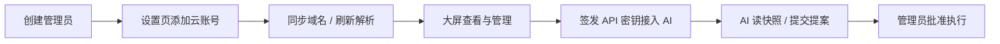
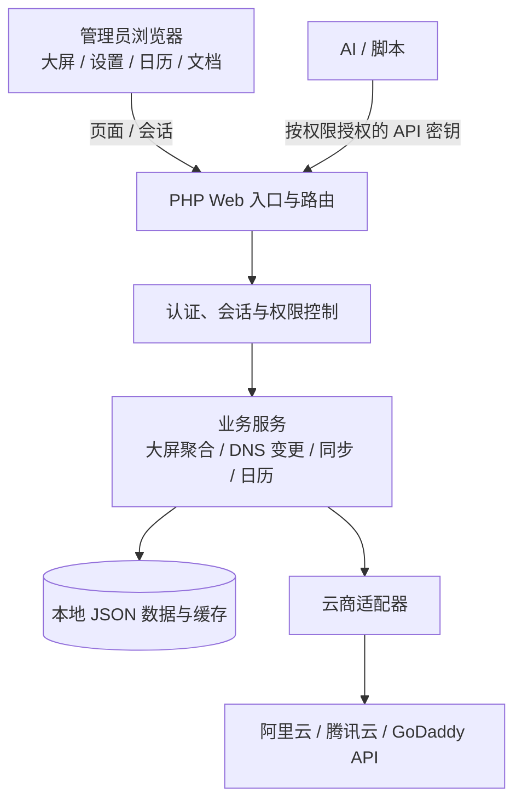

# 资产大屏 · Asset Workspace

**人看大屏：域名与 IP 资产一面墙；AI 用 API：读资产、管 DNS、提交提案。**

资产大屏是一款可自行部署的 PHP 资产管理工具，适合管理多个域名、服务器或网站的个人与小团队。它把云账号中的域名与解析记录、手工登记的公网 IP 汇总成一份深色大屏（`/screen`，域名 + IP 双视图），支持在屏上直接完成 DNS 批量操作与暂停解析；同时对外提供 AI 友好的 API（OpenAPI 3.1 + 权限范围密钥），AI 可读取资产快照、提交 DNS 变更提案，由管理员批准后执行。

[快速开始](#快速开始) · [产品能做什么](#产品能做什么) · [AI 接入](#ai-接入) · [架构设计](#架构设计)

> 当前版本：1.3.0。项目以单管理员、自行部署为定位；文档与示例中的资产均为合成数据。

## 产品能做什么

| 模块 | 主要能力 |
| --- | --- |
| 域名大屏（`/screen`） | 深色海报式卡片展示未过期域名：到期天数、子域名与 A 记录大数字、账号 Tab 联动筛选、搜索排序分页状态自动记忆。 |
| IP 大屏（`/screen` IP 视图） | 从 DNS 解析自动发现公网 IP，与手工登记 IP 合并：归属地（ipwhois.io）、ISP、关联域名、访问状态，一卡一 IP。 |
| DNS 管理（屏上直操作） | 弹窗多选子域名后批量改 IP、批量删除、Markdown 多行批量添加；只写一次并回读核实，冲突返回 409 不自动重试。 |
| 暂停 / 恢复解析 | 云商记录停用（保留记录、停止解析）：阿里云与腾讯云支持，GoDaddy 明确报错；同一套版本核对 + 回读核实护栏，暂停态在快照中透出。 |
| 同步与检查 | 按账号「更新数据」拉取台账并刷新解析缓存；前端 / 后端访问检查支持全选或多选范围，任一通过即通过，结果持久化。 |
| 手工登记 IP | 大屏上直接登记公网 IP（名称 / 端口 / 备注），与 DNS 自动发现按 IP 合并展示；「共 N 个域名」弹窗查看该 IP 全部关联域名。 |
| 文档库（`/docs`） | 浏览、编辑、新建、删除仓库 Markdown 文档（docs/ 目录 + 根白名单）；默认预览，编辑带行号，代码高亮与 mermaid 图表渲染。 |
| 设置页（`/settings`） | 云账号增删改与连接测试、API 密钥签发（权限范围 + 有效期）、修改记录与文档面板（系统概况 / CHANGELOG / DNS 变更记录 / 操作审计）、HTTP 代理与管理员密码。 |
| 日历页（`/calendar`） | 宽屏左右布局：月历打卡（心情 + 快捷短语 + 一句话）、待办任务、完整检查运行记录。 |
| AI 接入 | OpenAPI 3.1 契约、能力发现与 `/llms.txt` 使用说明；AI 可读大屏 Markdown 快照、提交 DNS 变更提案（管理员批准后执行）。 |

## 一个典型的使用流程



**几个容易混淆的概念：**

- **同步域名**是从云账号读取域名；**刷新 DNS 快照**是读取解析记录；**访问检查**是主动探测主机。三者互不等同。
- **DNS 自动发现**的 IP 表示解析指向它，可能是 CDN 或代理入口；**手工登记**是用户确认的服务器资产，同一 IP 可以两者皆是。
- 访问检查结果是某个时间点的证据。未检查 ≠ 正常；结果超过 24 小时按过时对待。

## 快速开始

### 1. 准备环境

- PHP 7.4 或更高版本，建议 PHP 8.x；安装 `curl`、`mbstring` 扩展。
- 访问检查需要可用的 PHP CLI、`proc_open` 和本机 DNS 解析能力。
- 本地体验可使用 PHP 内置服务器；生产环境请将 Web 根目录指向 `public/`，并配置 HTTPS。

### 2. 启动

在项目根目录运行：

```bash
./start.sh
```

也可以直接启动：

```bash
php -S 127.0.0.1:8080 -t public public/index.php
```

浏览器访问 `http://127.0.0.1:8080`，首次进入创建管理员账号，随后自动进入大屏。生产部署请参考 [Nginx 示例](deploy/nginx.conf.example)。

### 3. 开始使用

1. 在 `/settings` 云账号面板添加云账号并测试连接。
2. 回到大屏点「更新数据」同步域名并刷新解析缓存。
3. 需要管理 DNS 时，点击卡片弹窗批量操作；服务器 IP 可切到 IP 视图「＋ 添加 IP」手工登记。
4. 在 `/settings` AI API 面板签发密钥，把 OpenAPI 契约交给你的 AI 工具。
5. 仓库文档在 `/docs` 页面浏览与维护（编辑、新建、删除均进入操作审计）。

## AI 接入

实例对外提供 `/api/openapi.json`、`/.well-known/asset-workspace.json`、`/llms.txt`（AI 使用说明）、`/api/capabilities` 与 **`/api/ai/bootstrap.md`（AI 一次请求完成接入的自包含文档：使用说明 + 能力清单 + 写护栏速查 + 双视图当前快照）**。API 密钥按权限范围授权（`assets:read` / `assets:write` / `dns:read` / `dns:write` / `checks:run` / `sync:run` / `proposals:write`），账号配置与密钥管理仅允许管理员会话。

面向 AI 的核心入口：

- `GET /api/ai/bootstrap.md` — AI 接入首选入口：一个请求返回自包含接入包（说明 + 契约 + 护栏 + 双视图快照）。
- `GET /api/domains/screen.md` — 域名大屏的自包含 Markdown 快照（域名、子域名 A 记录、访问状态、可直接照做的 CRUD 指引），一个文件交给 AI 即可读写操作。
- `GET /api/domains/screen/report` — 每日异常报告（到期预警、访问异常、解析缺口、非公网记录），`?format=markdown` 直出正文；`php scripts/generate-screen-report.php`（`--prompt` / `--digest`）适合 cron 投喂。
- `GET /api/ips/screen.md` — IP 视图 Markdown 快照（IP、归属地、访问状态、关联域名）。
- `POST /api/proposals`（`proposals:write`）— AI 提交 DNS 变更提案，不直接写云端；管理员以会话调用 `POST /api/proposals/{id}/approve|reject` 批准或拒绝，批准时读取云端最新版本、单次写入并回读核实。
- `POST /api/domains/{provider}/{domain}/records/{recordId}/status`（`dns:write`）— 暂停 / 恢复单条解析记录（阿里云与腾讯云支持）。
- 写入护栏：修改 / 删除需 `expected_version`，新增需 `expected_revision`，冲突 409；HTTP 202 / `verified:false` 表示结果未确认，绝不自动重试写操作。

归属地说明：IP 归属地查询会把目标公网 IP 发送给第三方 [ipwhois.io](https://ipwhois.io/documentation)，结果仅为近似位置，缓存在 `data/ip_locations.json`。AI 使用 `checks:run` 调用 `POST /api/ips/{ip}/location` 显式刷新。

本机开发调试可用免登录模式：在 `config/` 下创建空的 `dev-unlock.flag` 文件，或以 `AW_DEV_UNLOCK=1` 环境变量启动 PHP。它只对 `127.0.0.1` / `::1` 的回环请求自动建立会话（与正常登录同权限、仍受 CSRF 保护）；删除文件或取消环境变量立即恢复「密码 + 图形验证码」登录，生产环境不会意外启用。

## 架构设计



浏览器负责展示和屏上操作；PHP 负责身份校验、业务逻辑和云商调用；数据与缓存保存在部署实例中。不同云商通过适配器接入。

| 位置 | 职责 |
| --- | --- |
| `public/` | Web 入口、页面、样式与前端脚本；Web 服务只公开此目录。`screen.php/js/css` + `screen-ip.js`（大屏双视图）、`settings-page.*` / `calendar-page.*` / `docs-page.*` / `admin-page.*`（独立管理页，头部与 Markdown 管线共享）、`vendor/`（本地自托管开源库：marked / DOMPurify / highlight.js / mermaid）、`app.php`（登录壳）。 |
| `app/controllers/` | 接收请求并组织响应。 |
| `app/services/` | 大屏聚合（`ScreenService` / `IpScreenService`）、IP 台账（`IpAssetService`）、DNS 变更（`DnsChangeService`）、同步、日历、提案等业务规则。 |
| `app/providers/` | 阿里云、腾讯云和 GoDaddy 的接口适配。 |
| `app/core/` | 路由、认证、HTTP 与 JSON 存储等基础能力。 |
| `config/`、`data/` | 实例配置、凭据、资产和运行数据，不应公开或提交。 |
| `scripts/` | 屏幕报告生成、文档迁移、打包与运维脚本。 |

## 安全、密码与网络

- 登录使用图形验证码和限流。登录页的“记住密码”会把账号和密码**明文保存在当前浏览器本地存储**；取消勾选可删除，请勿在公用设备使用。
- 忘记管理员密码时，在部署服务器的项目目录中运行 `php scripts/reset-admin-password.php`，按提示输入新密码。重置会保留资产和云账号，但原登录会话与 API 密钥失效。
- 云凭据保存在服务器私有配置中。生产环境应使用 HTTPS、最小权限云凭据，并确保 `config/` 与 `data/` 不可从 Web 访问。
- GoDaddy 连接受网络影响时，可在云账号编辑页配置可信的 HTTPS API 转发地址，或在设置页配置网络代理。凭据会发送到所配置的转发服务。
- 访问检查只探测公网目标：拒绝内网与保留地址，DNS 解析后固定连接地址，开启 TLS 校验且不跟随跳转。

## API 与开发

改动验收以手动验收为主（登录 → 大屏双视图 → 同步 → 设置 / 日历 / 文档页全链路），配合静态检查：

```bash
find app public/index.php public/views scripts -name "*.php" -exec php -l {} \; | grep -v "No syntax" || true
for f in public/assets/js/*.js; do node --check "$f"; done
python3 scripts/check-public-docs.py
```

构建源码发行包：

```bash
python3 scripts/package-release.py --output-dir dist
```

发行包包含程序、示例配置、公开文档与已审核的演示截图，不包含运行数据、实际配置或 Git 历史。
