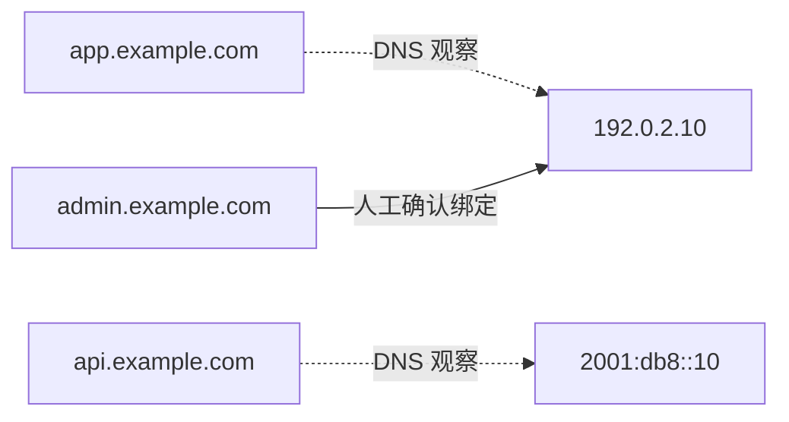

# 域名、子域名与 IP 关联说明

本文说明产品概念。以下数据全部为文档示例，不是本地快照、客户清单或当前部署环境的资产。

## 两种关联依据

| 依据 | 含义 | 使用方式 |
| --- | --- | --- |
| DNS 观察 | 某次采样中，域名或主机名解析到某个 IP | 作为入口线索，结合采样时间查看 |
| 人工确认绑定 | 管理员为域名登记了确认的 IP 绑定 | 作为人工维护的台账关系，资料变化时复核 |

DNS 观察不会自动证明源站归属。CDN、负载均衡和反向代理的入口地址可能与真实承载设备不同。关系图和反查列表展示已登记或观察到的关联，不保证覆盖全部业务依赖。

## 合成示例

| 示例域名 | 示例 IP | 关联说明 |
| --- | --- | --- |
| `app.example.com` | `192.0.2.10` | 用于说明 DNS 观察关系 |
| `admin.example.com` | `192.0.2.10` | 用于说明多个站点共享入口 |
| `api.example.com` | `2001:db8::10` | 用于说明 IPv6 资产 |

图中的地址仅用于文档，不是可用的测试服务，不应据此发起生产变更。

## 日常操作

1. 在域名列表搜索目标，查看 DNS 快照及其时间。
2. 进入资产关系，查看观察 IP 和人工确认绑定。
3. 从 IP 列表反查已知域名及子域名，阅读用途与备注。
4. 在迁移或解析变更后复核人工绑定，必要时重新检查。
5. 将真实导出和排查截图保存在本地私有位置，不写入产品文档。

[返回产品目录](00-目录.md)
