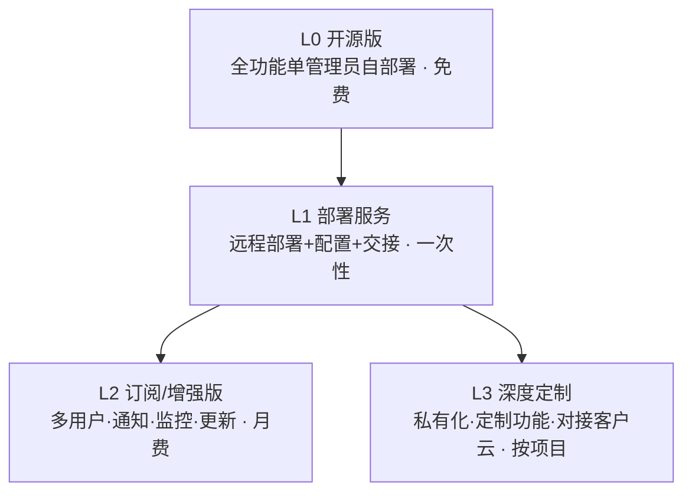

# 域名管家 · 推广获客与定制工作台服务方案

> 规划日期：2026-10-25　状态：方案稿
> 一句话定位：把「域名管家」从一个自用工具，做成「**先开源引流 → 再用定制部署/订阅变现**」的垂直运维工作台产品。

---

## 0. 先想清楚：你卖的是什么

推广和变现的前提是把产品价值说清楚。基于现有代码，域名管家的核心价值点有三：

| 价值点 | 现状（代码事实） | 对外卖点话术 |
|---|---|---|
| 多账号聚合 | 阿里云/腾讯云/GoDaddy 多账号 Provider 已实现 | 「一个面板，管完你所有云账号的域名」 |
| 资产关系可视 | 健康看板、资产关系图、域名↔子域名↔IP↔服务器 | 「一台服务器挂了，哪些网站受影响一眼看清」 |
| AI 原生接入 | OpenAPI 3.1、`llms.txt`、能力发现、分权限密钥 | 「AI 工具能直接对话操作你的资产」 |

其中 **AI 原生接入是最大差异化**（同类自托管工具极少有），推广时务必突出。

### 目标用户分层（决定话术与定价）

| 层级 | 画像 | 典型痛点 | 付费意愿 | 用途 |
|---|---|---|---|---|
| C0 个人站长/开发者 | 5–50 域名、多账号 | 散落难管、到期遗忘、DNS 全靠手工 | 低 | **引流与口碑** |
| C1 中小团队运维/技术负责人 | 公司资产、域名+服务器 | 资产台账不清、故障影响面不明 | 中 | **定制部署主客群** |
| C2 建站/代运维服务商 | 帮一批客户托管 | 批量客户运维、交付形象 | 高 | **SaaS/批量订阅** |

**主攻方向**：先靠 C0 打开声量，靠 C1/C2 变现。

---

## 1. 推广获客：流量从哪来

### 1.1 获客漏斗


每一层要有明确转化动作和衡量指标（见第 4 章）。

### 1.2 渠道矩阵与优先级

| 优先级 | 渠道 | 做什么 | 预期效果 | 指标 |
|---|---|---|---|---|
| P0 | **工具导航站收录** | 提交到 20+ 站（见 1.3） | 见效最快，长尾流量 | 收录后 UV |
| P0 | **开源（GitHub/Gitee）** | 完善 README、Release、Screenshots | 长期 SEO + 信任背书 | Star/Issue |
| P0 | **内容 SEO** | 技术博客长文 + 部署教程（见 1.4） | 持续精准流量 | 搜索排名/点击 |
| P1 | **技术社区** | V2EX、掘金、SegmentFault、即刻、Twitter/X | 口碑与讨论 | 点赞/转发/评论 |
| P1 | **视频** | B站/抖音/视频号演示工作台 | 破圈、可视化 | 播放/私信 |
| P2 | **垂直站长投稿** | 卢松松、站长之家、落伍者 | 精准站长人群 | 收录/回链 |
| P2 | **云市场/应用市场** | 如上架到可托管的 SaaS 形态 | 被动分发 | 下载/订单 |

### 1.3 工具导航站提交清单（P0，先做）

把下面这批做一次集中提交（标题统一、简介带关键词「域名管理 / DNS / 运维工作台 / 自托管」）：

- GitHub Trending 之外的中文工具站：**异次元、小众软件、利器、Appinn、实用工具箱、小工具集**
- 开发者导航：**掘金导航、开发者头条、菜鸟工具、开源中国软件库（Gitee 同步后）**
- 运维/站长站：**站长工具、爱站网、SEO 技术工具集**
- 英文：**Product Hunt、AlternativeTo、HackerNews 展示 HN、awesome-selfhosted、r/selfhosted、r/sysadmin**

> 每站准备一套统一描述（一段话 + 三张截图 + 一个演示链接）。

### 1.4 内容 SEO 选题表（P0/P1）

围绕用户搜索词布局，每篇长文在文末导流到项目主页/GitHub：

| 搜索词（用户会搜的） | 文章角度 | 对应卖点 |
|---|---|---|
| 多账号域名管理 | 《我如何用一个面板管完阿里+腾讯+GoDaddy 的 56 个域名》 | 多账号聚合 |
| 域名到期提醒 自建 | 《自建域名到期提醒，告别续费焦虑》 | 到期检查 |
| 域名 服务器 关联 运维 | 《怎么一眼看出「这台服务器挂了影响哪些网站」》 | 资产关系图 |
| AI 管理域名 | 《让 AI 直接帮你查 DNS、改解析：自托管工作台的 OpenAPI 接入》 | **AI 原生接入（差异化主打）** |
| 开源 运维工作台 | 《开源自托管域名运维工作台推荐》 | 整体 |

**写作原则（贴合你的偏好）**：每篇都给出可落地的步骤/截图/命令，不要纯理论；配关系图/截图。

---

## 2. 定制工作台服务：怎么变现

这里的核心逻辑：**把流量接住，转化成「定制工作台」的服务订单**。你卖的不是工具本身，而是「以域名管家为底座，帮客户搭一套专属的资产运维工作台」。

### 2.1 商业模式阶梯（由轻到重）



- **L0 开源版**：就是当前项目，免费自部署 → 引流 + 建立信任（获客工具，不是收入来源）。
- **L1 部署服务**：对「想要但不想折腾」的 C1 客户，提供远程部署、域名台账迁移、DNS 配置、交接培训，收一次性费用。
- **L2 订阅/增强版**：在开源版上加价值（多用户权限、邮件/飞书通知、服务器监控、自动续费提醒、长期更新维护），按月订阅。
- **L3 深度定制**：针对 C2 服务商或大客户，做私有化部署、定制功能、对接客户自己的云账号体系，按项目报价。

### 2.2 服务 SKU 与定价参考

| 档位 | 交付内容 | 定价参考 | 成交场景 |
|---|---|---|---|
| L1 部署版 | 远程部署 + 账号接入（阿里/腾讯/GoDaddy）+ 导入现有域名台账 + 交接培训（1 次） | ¥500–2000 / 单 | 有服务器但不想折腾的团队 |
| L2 订阅版 | 开源全功能 + 多用户权限 + 飞书/邮件到期通知 + 每月更新维护 + 技术支持 | ¥99–399 / 月 | 稳定使用的 C1/C2 |
| L3 深度定制 | 私有化部署 + 定制字段/页面 + 对接客户云账号 + 专属支持（含实施） | ¥5000–30000 / 项目 | C2 服务商、中大型团队 |

> 定价按「对你客户的价值」而非「你的工时」；对 C2 服务商可谈批量折扣（管理 N 个客户的批量部署）。

### 2.3 获客 → 转化的承接链路

1. **留资入口**：GitHub README / 官网 / 视频简介里放「定制部署咨询」入口（表单或微信）。
2. **漏斗话术**：开源版满足「自己能动手的」，话术引导「不想折腾/要多人用/要通知」的人来找你。
3. **私域承接**：沉淀到微信/飞书，用 1 份《需求确认清单》标准化接单（见 2.4）。
4. **首个标杆案例**：做出 1–2 个真实部署案例（截图+验收清单），成为后面所有成交的信任材料。

### 2.4 接单交付流程（可直接用）

```
咨询 → 需求确认清单 → 报价 → 预付款(50%) → 部署+迁移 → 验收 → 尾款 → 维护期
```

**需求确认清单（发给客户填）**：
- [ ] 部署环境：VPS / 虚拟主机 / 内网？有无定时任务、后台进程、数据库？
- [ ] 云账号：阿里/腾讯/GoDaddy？几个账号？是否需要脚本/API 导入？
- [ ] 资产规模：现有域名、服务器数量？有无可导入的资产表（CSV）？
- [ ] 使用者：单管理员还是多人？是否需要分权限？
- [ ] 通知渠道：需要邮件/飞书/微信提醒吗？
- [ ] 定制项：字段、页面、对接系统是否需要改动？
- [ ] 安全要求：密钥存放、HTTPS、访问控制？

**合同要点（务必写进）**：
- 云 AccessKey 由客户在自有环境填写，**你不接触/不保存客户密钥**（项目本身已做到密钥不落库，这既是卖点也是免责点）。
- 明确交付范围（部署+迁移+培训）与「后续定制另行报价」。
- 明确维护期时长与售后边界。

---

## 3. 90 天落地执行计划

分四个阶段推进，每阶段有明确产出。

| 阶段 | 时间 | 核心动作 | 产出/里程碑 |
|---|---|---|---|
| ① 定位与物料 | 第 1–2 周 | 定卖点文案、拍演示截图/GIF、准备统一简介与工具站描述、确认定价 | 一套对外物料（README 优化 + 演示图 + 简介模板） |
| ② 冷启动 | 第 3–4 周 | 提交 20+ 工具导航站、发 2–3 篇 SEO 长文、发布 GitHub Release | 首个导航站收录、第一波自然流量 |
| ③ 社区与开源放量 | 第 5–8 周 | V2EX/掘金/即刻发帖、写 2 篇部署教程、Gitee 同步、上 Product Hunt/HN | Star 增长、形成讨论 |
| ④ 转化与首个客户 | 第 9–12 周 | 上线定制咨询入口、跑通需求清单+报价流程、交付 1–2 个真实部署案例 | 首个付费订单 + 标杆案例 |

### 里程碑检查点

- 第 4 周：有 ≥5 个工具站收录 + 累计自然访问稳定。
- 第 8 周：GitHub Star 过百 / 有真实用户安装反馈。
- 第 12 周：≥1 个付费部署订单，产出标杆案例文档。

---

## 4. 关键指标（衡量是否跑通）

| 环节 | 指标 | 目标参考 |
|---|---|---|
| 曝光 | 工具站收录数、社区帖子数、视频播放 | 工具站 ≥5、视频 ≥1 |
| 访问 | 官网/GitHub UV、搜索来源占比 | 自然访问稳定上升 |
| 留资 | 咨询入口点击、表单提交 | 开始出现咨询 |
| 转化 | 部署单数、订阅数 | 第 12 周 ≥1 单 |
| 口碑 | Star、Issue、转发、真实使用反馈 | 持续正向 |

---

## 5. 风险与合规（必须注意）

| 风险 | 说明 | 应对 |
|---|---|---|
| 云密钥安全 | 客户密钥若泄露是最大信任风险 | 强调密钥本地保存、不接触客户密钥；建议定期轮换 AccessKey |
| 隐私/责任 | 你提供的部署服务会接触客户资产配置 | 合同明确数据归属与责任边界；部署版建议客户自备服务器 |
| 免费与付费边界不清 | 开源版太全则没人买订阅 | 明确「部署/多人/通知/定制」是需要付费服务的增量 |
| 竞品 | 已有 Cloudflare、各类 SaaS 面板 | 差异化押在「**AI 原生接入 + 自托管 + 资产关系可视**」上 |

---

## 6. 附：对外物料一页模板（可直接改）

```
【域名管家 · 自托管域名与服务器运维工作台】

一个开源、自托管的运维工作台：聚合阿里云/腾讯云/GoDaddy 多账号域名，
用资产关系图看清「服务器↔网站↔域名」的影响面，带到期提醒、DNS 管理与健康检测，
并原生支持 OpenAPI / llms.txt，AI 工具可直接对话操作你的资产。

· 多账号聚合   · 资产关系可视   · DNS 批量管理   · AI 原生接入
· 到期提醒     · 自托管、密钥本地保存

演示/文档：<你的链接>　　定制部署咨询：<你的入口>
```
