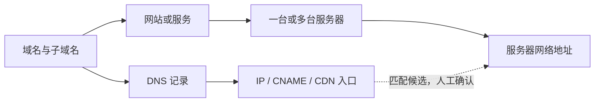

# 域名与服务器工作台规划

规划日期：2026-10-23。状态：规划稿，尚未实施。

用户已确认第一版范围：**资产台账＋域名关联＋到期与可用性检查**。

## 1. 目标

把当前“域名管家”升级为个人运维工作台。打开首页即可回答：

1. 我有哪些域名和服务器，分别在哪个账号、用于哪个项目？
2. 某个域名和子域名承载什么服务，关联哪台服务器？
3. 某台服务器发生异常或准备迁移时，会影响哪些站点与域名？
4. 哪些资产即将到期，哪些服务检查异常，哪些资料或关联尚未补齐？

第一版以单管理员、少量服务器和现有域名规模为设计基线。云服务器自动同步、CPU/内存采集、SSH、部署、重启、自动续费放入后续版本。服务器控制台和管理面板可作为快捷链接登记。

## 2. 当前项目分析

### 2.1 已有基础

| 项目 | 已实现情况 | 后续处理 |
|---|---|---|
| 后端 | PHP，自建 Router、Controller、Service、Provider | 保留分层并逐步整理 |
| 前端 | PHP 页面外壳＋原生 JavaScript/CSS | 改成工作台布局，按模块拆分 |
| 域名来源 | 阿里云、腾讯云、GoDaddy 多账号适配 | 复用，补错误处理和能力边界 |
| 域名管理 | 同步、搜索、排序、到期筛选、手工增改删 | 增加项目、标签、关联、详情页 |
| DNS 管理 | 记录增改删；页面支持批量改 TTL、记录值、删除 | 保留并优先修正结果判定与审计 |
| 检测 | 域名及部分 DNS 记录的 HTTP 探测 | 拆分服务可用性、DNS、TLS 检查 |
| 账号 | 配置文件提供账号；界面展示和测试密钥 | 改为“账号与集成”，显示能力与最近结果 |
| 存储 | JSON 文件 | 在引入关联模型时迁移到关系型数据库 |
| 服务器 | 未发现实体、页面、API 或云主机适配 | 新增资产台账 |

本地快照包含 56 条域名记录、56 个唯一域名，涉及 3 个账号标识；均有到期字段，暂无备注。最后同步为 **2026-08-18 03:59:15**，最后全量访问检测为 **2026-08-18 04:20:43**。这些是历史快照，不代表 2026-10-23 的云端资产和运行状态。

检查范围：代码静态阅读、JSON 结构与数量统计，以及 23 个 app/public PHP 文件的语法检查（通过）。未调用云商 API，未验证线上 DNS 操作或实际服务器状态。未展示或读取配置中的密钥值。

当前目录不是 Git 仓库，也未发现 README 所声称的 `.gitignore`。进入实施阶段时需要建立版本管理、配置示例、忽略规则和数据备份；当前不初始化或提交。

### 2.2 优先解决的问题

| 优先级 | 代码事实 | 对工作台的影响 | 规划处理 |
|---|---|---|---|
| P0 | `app.js` 的 API 包装未统一将 `ok:false` 作为失败；批量循环在请求返回后直接累计成功 | 云商修改失败可能显示成功 | 统一 HTTP/业务错误契约，逐项反馈真实结果 |
| P0 | 阿里云错误判断把 `RequestId` 等字段作为排除条件 | 含这些字段的错误响应可能被当成成功，并进入同步合并 | 对明确错误码优先报错，验证响应结构及拉取完整性 |
| P0 | 同步成功后将“未再返回”的域名直接标记 `valid=false` | 不完整响应或来源差异可能被表现为资产失效 | 分开“来源未发现”“已过期”“已停用”；完整同步才能更新缺失状态 |
| P0 | HTTP 探测关闭证书验证；记录探测中任意目标成功即可标为正常 | 证书问题无法识别，直接 IP 可达可能掩盖实际域名异常 | 域名、TLS、直接端口分别判定；不以 IP 成功替代域名成功 |
| P0 | GoDaddy 删除从复合记录 ID 中仅保留类型与名称，更新也未使用旧记录值 | 单条界面操作无法明确表达旧值，存在记录组操作范围不一致风险 | 在继续写操作前核对接口语义，覆盖同名同类型多值记录场景 |
| P1 | 注册管理和 DNS 管理共用单一账号定位参数 | 无法清楚表达“甲处注册、乙处解析” | 分离注册账号、DNS 托管区及账号 |
| P1 | JSON 的读取和写入不是同一事务 | 同步、人工编辑与检测并发时存在覆盖更新风险 | 数据库事务、唯一约束、任务互斥 |
| P1 | 资产控制器未检查 JSON 写入返回值 | 磁盘或权限问题导致保存失败时仍可能提示成功 | 写入错误必须向调用方传播并保留失败记录 |
| P1 | 同步/全量检测占用一次 HTTP 请求 | 操作等待长，无法可靠查看进度和重试 | 后台任务＋持久化状态＋页面轮询 |
| P1 | 域名列表截取前 1000 条；阿里/腾讯 DNS 列表仅请求一页 | 规模增加后可能缺数据 | 完整拉取云端分页，本地列表分页 |
| P1 | 前端约 1000 行集中在 `app.js`，DNS 集中在弹窗 | 添加服务器、详情页、关联流程会继续增加耦合 | 模块拆分，稳定 URL，详情页与轻量抽屉分工 |
| P1 | 密码直接与配置字符串比对；环境诊断免登录；DNS 修改缺完整审计 | 扩展管理操作前需要补齐基础控制 | 密码哈希、写操作 CSRF 防护、诊断访问控制、变更审计 |

云商接口当前版本、权限要求及 GoDaddy 同名同类型记录组的更新/删除语义，需要在实施适配器时核对官方文档并做隔离验证。当前静态分析不将其视为已经通过云端验证。

## 3. 工作台信息架构

首版左侧导航收敛为五项：**工作台、域名管理、服务器管理、提醒与检查、设置**。顶部全局搜索支持域名、子域名、IP、服务器名称、项目名称；筛选条件保存在 URL，支持刷新、前进后退和直接打开详情。下表中的网站/服务作为域名及服务器详情的关联分区；账号与集成、任务与日志放在设置下，首页提供快捷入口。

| 页面 | 主要内容 | 日常动作 |
|---|---|---|
| 工作台 | 域名数、服务器数、临近到期、检查异常、资料待补齐、数据更新时间 | 进入待办、登记资产、执行同步/检测 |
| 域名管理 | 域名、注册商/账号、DNS 托管方、所属项目、关联服务器、到期、最近检查 | 查找、筛选、编辑备注、管理 DNS、建立关联 |
| 服务器管理 | 名称、供应商/账号、地区、IP、配置摘要、用途、到期、关联站点、最近检查 | 新增/导入、编辑、关联站点、打开控制台 |
| 网站/服务 | 服务名称、项目、域名/子域名、访问地址、部署服务器、环境 | 管理服务绑定、设置检查目标、看影响范围 |
| 提醒与检查 | 到期日历、异常记录、恢复记录、待补齐资料 | 按资产定位，标记处理、暂缓提醒、复查 |
| 账号与集成 | 供应商、账号别名、用途/权限、最近测试及同步结果 | 测试连接、查看失败原因、打开供应商控制台 |
| 任务与日志 | 同步/检测进度、逐项失败、操作人、变更前后值 | 重试失败项、追溯操作 |

“网站/服务”是轻量关联层，不承担发布部署功能。它可以表达多个域名指向同一服务、一个域名下有多个服务，以及一个服务部署在多台服务器上的情况。简单关联允许自动创建默认服务条目，用户可直接从域名选择服务器；无需先手工建立完整的项目和服务目录。

首页布局建议：

```text
┌ 导航 ─────┬ 全局搜索：域名 / IP / 服务器 / 项目 ──────────┐
│ 工作台    │ 域名数   服务器数   临近到期   检查异常       │
│ 域名      ├────────────────────────────────────────────┤
│ 服务器    │ 今日需处理                │ 数据与同步状态 │
│ 提醒检查  │ · 到期资产                │ 最近成功时间   │
│ 设置      │ · 检查异常                │ 失败账号/任务  │
│           │ · 未关联/资料缺失          │ 重新执行入口   │
│           ├────────────────────────────────────────────┤
│           │ 最近访问资产 / 最近变更 / 常用控制台链接    │
└───────────┴────────────────────────────────────────────┘
```

空值显示“未录入”，未检查显示“未检查”，超过检查有效期显示“结果已过时”。不把未知、未配置或不适用的项目渲染成绿色正常或红色故障。

## 4. 第一版功能细化

### 4.1 域名管理

- 保留同步、手工录入、到期筛选和 DNS 操作。
- 列表分开显示注册商、注册账号、DNS 托管方，增加项目/标签和关联服务器。
- 到期条件改为显式筛选，允许与账号、项目等条件组合；首页卡片跳转生成完整筛选条件，防止残留旧条件导致数量与明细不一致。
- 详情页包含概览、DNS、关联服务与服务器、检查历史、操作日志。
- DNS 变更显示修改前后值、目标账号和涉及范围；批量结果逐项显示成功与失败。
- 本地归档、移除关联和云端 DNS 删除使用不同操作名称。
- 云商字段与人工字段分开：同步不能覆盖项目、标签、用途、备注、人工绑定。人工修正同步字段时记录覆盖值与原因。
- 首版继续从现有配置加载云账号，新增元数据展示；在线编辑密钥作为独立后续功能，避免将秘密写入普通资产表或导出文件。

### 4.2 服务器资产台账

最小必填：服务器名称、供应商或“自建”、至少一个地址或可识别的实例编号。其他字段允许后补。

| 分组 | 字段 |
|---|---|
| 身份 | 稳定 ID、名称、供应商、账号别名、实例编号、地区 |
| 网络 | 多个公网/私网 IPv4/IPv6、可选管理域名、指定检查端口 |
| 配置 | CPU、内存、磁盘、系统（人工登记，明确标注来源） |
| 用途 | 项目、标签、环境、备注、关联网站/服务 |
| 生命周期 | 使用中/备用/退役、购买日、计费类型、到期日、可选费用和币种 |
| 入口 | 云控制台、管理面板、监控页面链接 |
| 检查 | 目标、最近时间、结果、错误原因、历史记录 |

支持手工增改、CSV 导入导出；导入先预览与校验，并提示重复/冲突。到期日允许“未知”或“不适用”，按量计费设备不强制填写到期日期。

台账“使用中”代表人工生命周期状态；端口可达代表某项检查成功。二者均不冒充云端实例运行状态或 CPU/内存实时指标。

### 4.3 域名、服务与服务器的关联



手工绑定是第一版的确定关联来源。A/AAAA 记录与已登记 IP 精确匹配时给出候选；CNAME 链、CDN、负载均衡和反向代理只提供线索，不能据此自动认定源站。

关联保存来源、确认状态、确认时间及备注。界面区分“已确认关联”和“根据 DNS 推测”。解析变更后提示复核，不自动覆盖人工绑定。

关键流程：在域名详情选择/新建服务 → 关联服务器 → 查看完整关系；在服务器详情反向显示服务、域名、检查目标，并提示哪些影响关系还未确认。

### 4.4 到期与可用性检查

- 到期：域名和服务器默认提供 30/15/7 天及已到期视图；阈值可配置，时间统一使用 Asia/Shanghai。
- 公网服务：以明确的协议、主机名、端口和路径为检查目标，记录预期响应规则。
- HTTP：优先按目标协议检查；HEAD 不受支持时在同一协议下用受限 GET 复核；不自动以 HTTP 正常掩盖 HTTPS 故障。
- TLS：独立展示证书有效期、验证失败和即将到期；正确使用主机名及 SNI。
- DNS：展示解析结果和采样时间，区分无解析、查询失败、结果变化。
- 服务器：按已配置 TCP 端口检查；未设置检查目标时为“未配置”。不将网站 403/404、未开放 HTTP 端口直接等同于服务器宕机。
- 未部署网站的域名默认只检查到期与 DNS；不强制执行网站可用性检查。
- 公网探测需验证输入、解析后地址及每次重定向地址；阻止访问回环、云元数据等不应访问的目标。内网资产可登记，首版没有合适探测点时显示“当前不可检查”。
- 记录检测点；单点失败只说明从该检测点检查失败。连续失败形成异常事项，恢复后关闭，避免每次检查重复产生提醒。
- 第一版提供站内提醒；消息渠道接入与外部通知另行配置。

## 5. 数据与技术方案

建议保留 PHP 后端、原生前端技术，先按业务模块拆分，避免同时迁移语言和前端框架。当前扩展的主要需求是资产关联、结果可信和后台任务。

### 5.1 核心数据实体

| 实体 | 作用 |
|---|---|
| accounts | 供应商类型、账号别名、可用能力、凭据引用 |
| domains | 规范化域名、注册账号、注册信息、人工业务信息、来源映射 |
| dns_zones / dns_records | DNS 托管账号、托管区、记录快照及云端标识 |
| servers / server_addresses | 服务器资产、多个地址和网络类型 |
| projects / services | 项目与实际网站或服务 |
| service_domains / service_servers | 服务绑定的主机名与部署服务器，多对多关系 |
| checks / check_runs | 检查配置、每次结果、时间和错误分类 |
| jobs / job_items | 后台任务、进度、逐项结果、重试状态 |
| reminders / audit_logs | 到期和异常事项、处理状态、操作审计 |

旧字段 `provider` 实际用于账号 ID，不直接沿用为新的“供应商类型”。迁移时显式映射为来源账号，保留旧键，规范化域名并检查冲突；稳定内部 ID 与云端 ID 分离。注册商账号和 DNS 账号允许不同。

### 5.2 存储选择

首版默认采用 SQLite：前提是单实例部署、数据库位于本地可写磁盘，具备 SQLite 驱动和定时执行条件。使用事务、索引、约束及版本化迁移，控制写事务时长。

若实际部署需要多实例、数据库在网络共享目录，或主机仅提供 MySQL，则在开发前切换到 MySQL 方案。部署位置与可用扩展目前尚未确认，不直接引入 Redis、独立消息队列或微服务。

### 5.3 后台任务与接口

- 创建同步/检测任务立即返回任务 ID；独立 CLI worker 或计划任务处理，前端轮询进度。
- 同账号/资产的重复任务去重，任务包含锁、心跳、超时、重试次数和失败原因。
- 分别记录最近尝试与最近成功时间；全部同步失败时不得更新最近成功时间。
- 不把在单次 Web 请求末尾继续执行当作可靠后台任务。部署环境若不支持计划任务，需要先解决执行方式。
- 页面 GET 请求读取数据库快照并显示采集时间；主动刷新通过任务完成。
- 统一成功/失败响应和状态码，验证输入，失败写入审计，不使用 HTTP 200 掩盖所有业务错误。
- 域名注册、DNS、服务器资产导入分别定义能力接口；既有 Provider 按能力适配，不强行假设每个供应商都提供所有能力。
- 典型路由：`/api/overview`、`/api/servers`、`/api/services`、`/api/checks`、`/api/jobs/{id}`、`/api/reminders`，域名接口逐步迁移到稳定内部 ID。

### 5.4 迁移和回退

1. 备份现有 JSON 与配置；秘密不进入版本库或普通导出。
2. 校验 JSON 结构、数量、域名和来源键；生成迁移预览。
3. 事务导入并保留原始来源映射，导入过程可重跑且不重复创建资产。
4. 将本地 56 个唯一域名逐一对账；历史检测保留原始时间并显示为过时。
5. 校验列表、筛选、到期、备注及来源；新旧系统只允许一端写入。
6. 切换前保留可回退快照；切换后新写入数据需有导出/反向迁移路径，不能靠直接换回旧 JSON 回退。

## 6. 实施顺序与验收

| 阶段 | 交付内容 | 验收标准 |
|---|---|---|
| A：结果可信与基础整理 | 修正 API/同步错误判定、DNS 批量结果；基础鉴权、审计和备份；存储迁移 | 云商失败不会显示成功或批量失效；56 个域名对账；编辑与同步不丢人工资料 |
| B：工作台与资产 | 导航、全局搜索、域名详情、服务器台账、项目/服务关联、CSV 导入导出 | 能登记一台服务器，关联多个域名，并在两侧互相查询 |
| C：检查与提醒 | 持久化任务、定时执行、到期提醒、DNS/HTTP/TLS/TCP 检查、结果时效 | 页面不阻塞；旧数据不显示当前正常；失败/恢复可追溯；未知与不适用清楚区分 |
| D：回归与交付 | 迁移演练、异常场景验证、部署说明、备份恢复演练 | 能从域名定位服务器，从服务器查看受影响服务，并完成一条提醒处理流程 |

第一版完成标准：**资产查得清、关系查得到、数据时间看得见、异常有依据、到期不遗漏**。

必须覆盖的回归场景：业务失败却返回 200、同步部分失败、云端分页缺失、重复导入、同步与人工编辑并发、一个域名多个服务器、CDN 无法确认源站、HTTP 受限但 TCP 可达、TLS 过期、长期未检查、按量服务器无到期日、探测目标跳转到受限地址。

## 7. 后续边界与待确认项

后续可选：云服务器资产自动同步、资源监控、额外通知渠道、多人权限，再考虑 SSH 和部署操作。当前不纳入第一版验收。

实施前需要确认：

1. 部署在 VPS、虚拟主机还是本机；是否有定时任务、后台进程和数据库支持。
2. 服务器数量、主要供应商、是否包含内网机器，以及是否已有可导入的资产表。
3. 是否全部由一人管理。若涉及多人，需要提前设计资产可见性及操作权限。

这些信息不影响当前页面与关系模型的规划；会影响数据库、后台任务执行方式及导入安排。

## 8. 主要代码依据

- `public/views/app.php:35`：现有仪表盘、域名列表、测试 Key 导航。
- `public/index.php:20`：账号、同步、域名、DNS、检测路由；尚无服务器路由。
- `public/assets/js/app.js:16`：API 响应判断；`:676` 等批量成功累计。
- `app/providers/AliyunProvider.php:141`：错误判断；`:156` 单页 DNS 拉取。
- `app/providers/TencentProvider.php:143`：单页 DNS 拉取。
- `app/services/SyncService.php:74`：按账号与域名合并；`:119` 失效标记。
- `app/services/AccessService.php:44`：HTTP 结果分类；`:201` 证书验证选项。
- `app/services/RecordAccessService.php:76`：任一目标可达即正常。
- `app/core/JsonStore.php:26`：临时文件替换；`:44` 读后追加写入。
- `app/controllers/DomainController.php:99`：列表截断。
- `app/core/Auth.php:28`：配置口令校验；`public/index.php:46`：免登录环境诊断。
